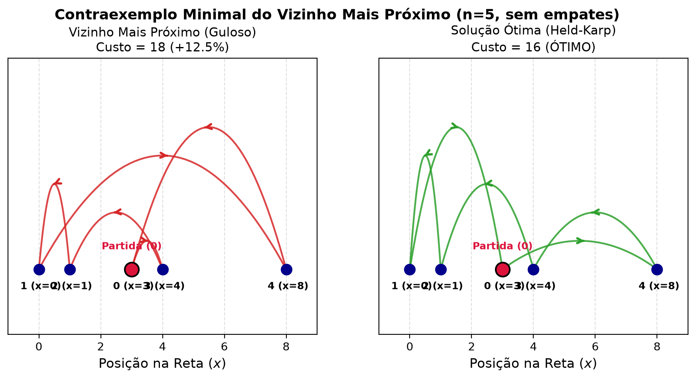
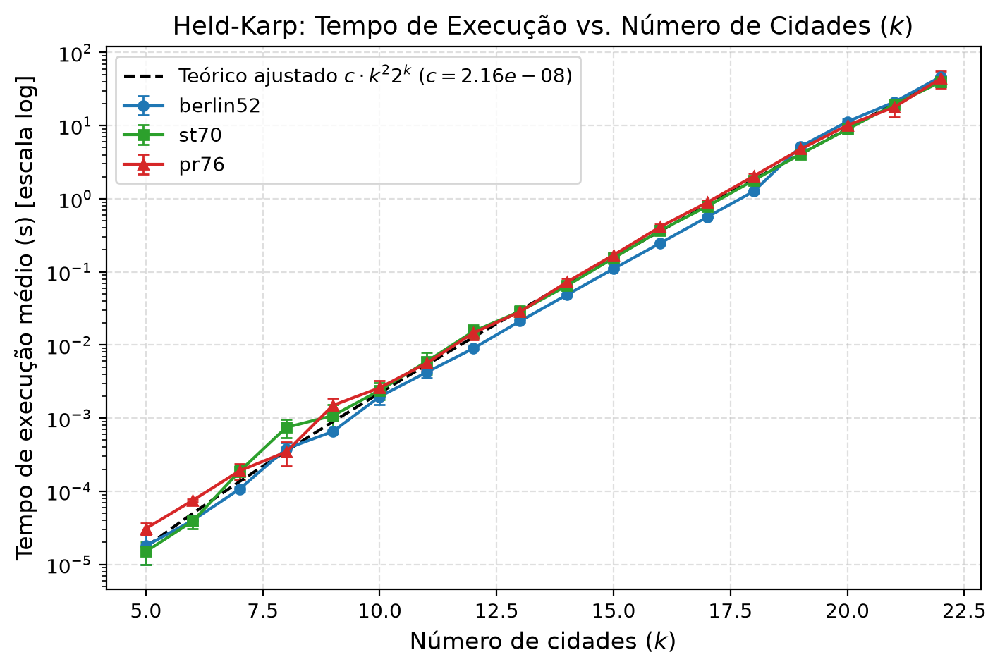
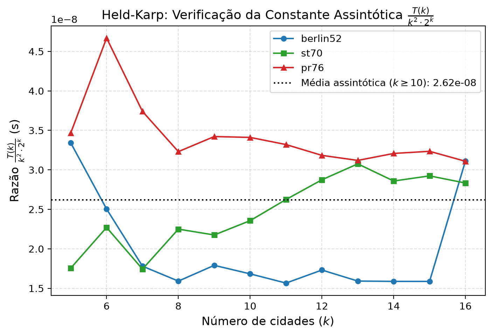
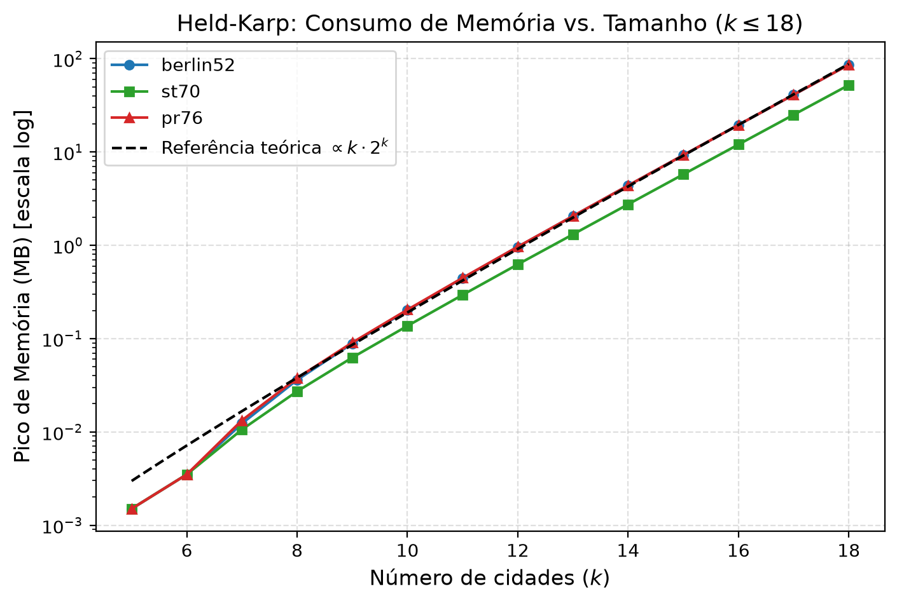
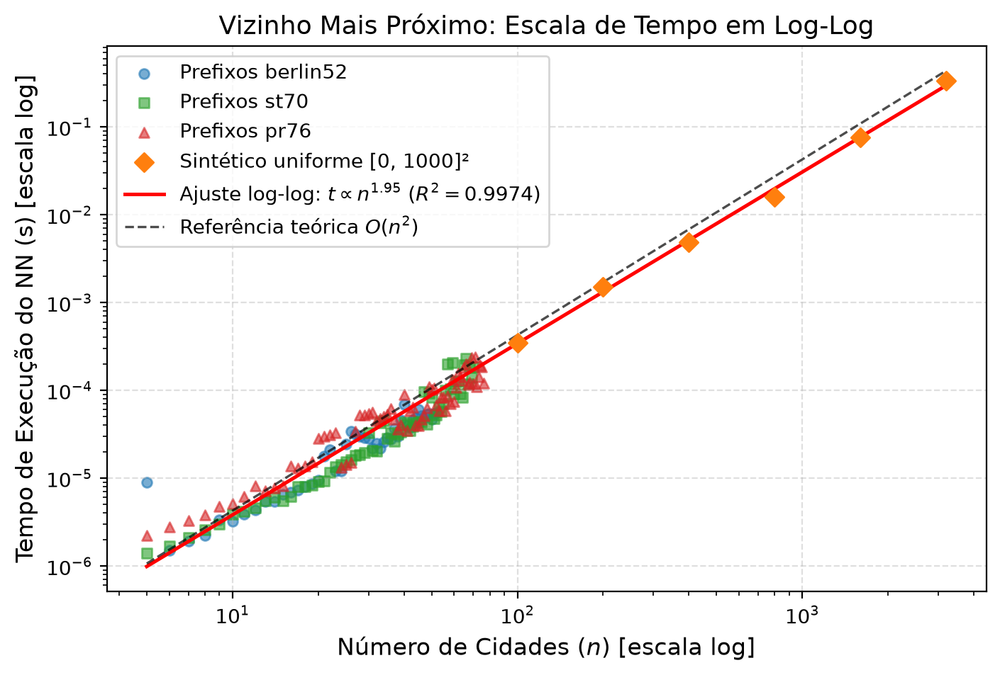
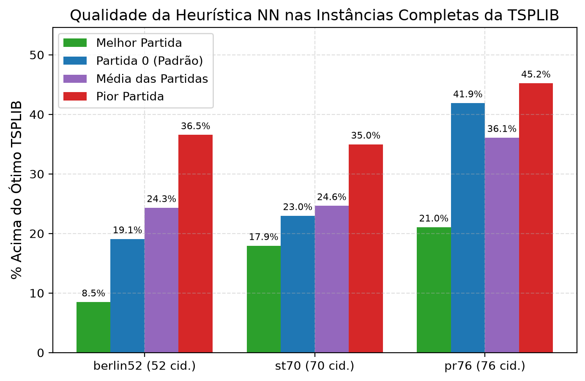
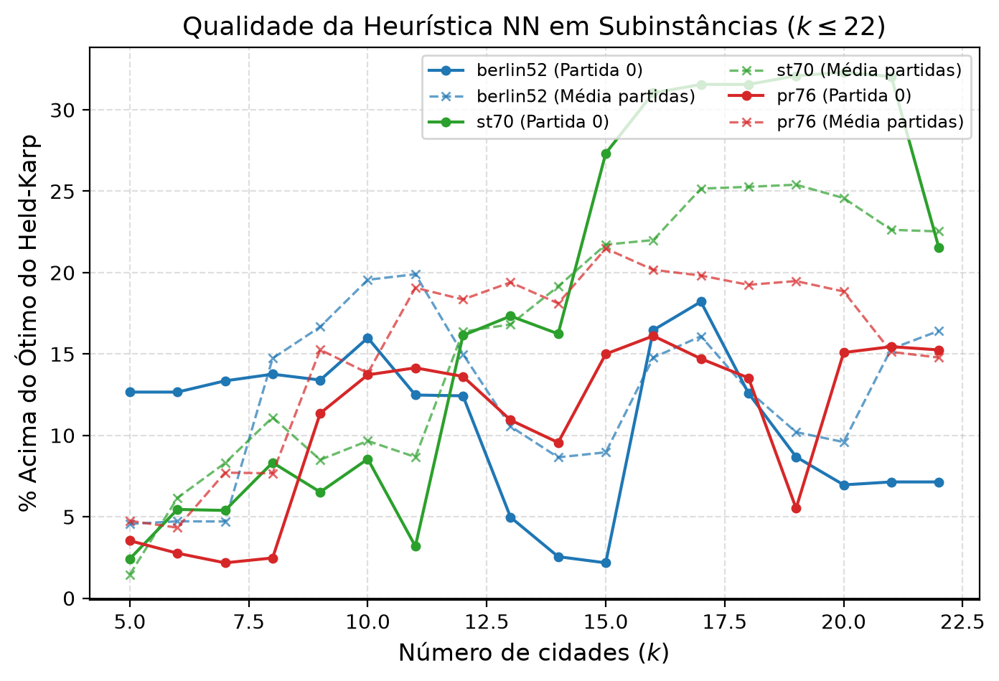

# Projeto e Análise de Algoritmos para o Problema do Caixeiro Viajante Simétrico: Abordagem Exata (Held-Karp) versus Heurística Gulosa (Vizinho Mais Próximo)

**Instituição:** [PREENCHER: Nome da Instituição de Ensino Superior]  
**Disciplina:** [PREENCHER: Projeto e Análise de Algoritmos]  
**Docente:** [PREENCHER: Nome do Professor]  
**Discentes:** [PREENCHER: Nomes e Matrículas dos Integrantes do Grupo]  
**Data:** [PREENCHER: Data de Entrega]  

---

## Resumo

Este trabalho apresenta o projeto, a fundamentação teórica, a implementação e a experimentação empírica de dois algoritmos de paradigmas distintos para o Problema do Caixeiro Viajante simétrico (TSP): o algoritmo exato de Held-Karp, fundamentado em programação dinâmica com complexidade de tempo $\Theta(n^2 \cdot 2^n)$ e espaço $\Theta(n \cdot 2^n)$, e a heurística construtiva do Vizinho Mais Próximo, de paradigma guloso com complexidade $\Theta(n^2)$. Os algoritmos foram avaliados em instâncias padronizadas da biblioteca TSPLIB (`berlin52`, `st70`, `pr76`) e em instâncias sintéticas de até $n = 3200$ cidades. Os resultados experimentais confirmam estreita concordância com a teoria: o Vizinho Mais Próximo exibiu inclinação empírica log-log de $1{,}9521$ ($R^2 = 0{,}9974$), processando $3200$ cidades em $0{,}34\text{ s}$ com gap médio de $13{,}29\%$ nas subinstâncias. O Held-Karp confirmou fator médio de crescimento de $2{,}37\times$ por cidade adicional ($R^2 = 0{,}9987$), atingindo $k = 22$ cidades como o limite máximo resolvível em tempo razoável ($\le 60\text{ s}$), com extrapolação estimada de $12{,}72\text{ horas}$ para $k = 30$.

---

# 1. Introdução e Definições Iniciais

O Problema do Caixeiro Viajante (*Traveling Salesperson Problem* – TSP) figura entre os problemas mais estudados da ciência da computação e da pesquisa operacional, constituindo um marco clássico na teoria da complexidade computacional. A formulação simétrica requer encontrar um ciclo hamiltoniano de custo total mínimo em um grafo ponderado e não direcionado, visitando cada vértice exatamente uma vez antes de retornar à cidade de partida.

Para atender à Etapa 1 do trabalho acadêmico, selecionou-se um par de algoritmos baseado em dois paradigmas algorítmicos essenciais:
1. **Algoritmo Exato por Programação Dinâmica (Held-Karp):** explora a subestrutura ótima e a sobreposição de subproblemas para determinar com exatidão a solução global mínima. A escolha deste algoritmo fundamenta-se na sua relevância histórica como a formulação de programação dinâmica seminal que reduziu o custo assintótico da busca exaustiva fatorial $\Theta(n!)$ para a classe exponencial $\Theta(n^2 \cdot 2^n)$.
2. **Algoritmo Heurístico Construtivo (Vizinho Mais Próximo):** adota a estratégia gulosa (*greedy*), na qual decisões locais imediatas e irrevogáveis selecionam o próximo vértice com base exclusivamente na menor distância a partir do nó atual. Trata-se de uma heurística clássica de baixo custo computacional $\Theta(n^2)$, ideal para contrastar com a rigidez do método exato.

A justificativa para a escolha desse par reside no contraste metodológico, assintótico e prático: o algoritmo exato garante a rota ótima global ao custo de um crescimento exponencial em tempo e memória que restringe sua viabilidade a pequenas instâncias ($n \le 22$); em oposição, a heurística gulosa sacrifica a garantia de otimalidade em troca de um tempo de resposta praticamente instantâneo mesmo para milhares de vértices. Ressalta-se que o escopo deste estudo é estritamente limitado ao TSP simétrico com os algoritmos de Held-Karp e Vizinho Mais Próximo, sem o emprego de métodos alternativos (como *branch-and-bound*, aproximação por árvore geradora mínima ou problemas de roteamento de veículos com capacidade).

O restante deste documento está estruturado da seguinte forma: a Seção 2 formaliza a modelagem matemática do problema, a estrutura de dados adotada, a dedução do espaço de soluções e a caracterização da complexidade; as Seções 3 e 4 detalham o projeto, os pseudocódigos, as provas de corretude e as análises assintóticas dos algoritmos exato e heurístico, respectivamente; a Seção 5 descreve as decisões de implementação que impactam o custo; a Seção 6 documenta a metodologia e os resultados da experimentação quantitativa; a Seção 7 discute os dados à luz das previsões teóricas; a Seção 8 sintetiza as conclusões; e os apêndices detalham as instruções de reprodução e as pendências de formatação.

---

# 2. Modelagem

## 2.1 Definição Formal do Problema

O Problema do Caixeiro Viajante Simétrico é formalizado como se segue:

* **Entrada:** Um conjunto finito de $n$ vértices (cidades) $V = \{0, 1, \dots, n-1\}$ e uma função simétrica de distância $d: V \times V \to \mathbb{Z}_{\ge 0}$ tal que $d(i, j) = d(j, i)$ para quaisquer $i, j \in V$, com $d(i, i) = 0$.
* **Saída:** Uma permutação cíclica $\pi = (\pi_0, \pi_1, \dots, \pi_{n-1})$ dos vértices de $V$, representando a ordem sequencial de visita das cidades, onde cada vértice aparece exatamente uma vez.
* **Função Objetivo:** Minimizar a função de custo total do ciclo hamiltoniano fechado:
  $$C(\pi) = \sum_{k=0}^{n-2} d(\pi_k, \pi_{k+1}) + d(\pi_{n-1}, \pi_0)$$

## 2.2 Representação do Grafo

O problema é modelado sobre um grafo completo, não direcionado e ponderado $G = (V, E, w)$, onde cada par não ordenado $\{i, j\} \subseteq V$ possui uma aresta associada com peso $w(i, j) = d(i, j)$.

Para a representação computacional de $G$, optou-se por uma **matriz de adjacência** $n \times n$ bidimensional, em detrimento de uma lista de adjacência. A justificativa técnica decorre das seguintes propriedades do problema:
1. **Densidade Máxima do Grafo:** O grafo é completo ($|E| = n(n-1)/2$). Em grafos densos, a lista de adjacência não economiza memória em relação à matriz e incorre em sobrecarga adicional de ponteiros, referências a objetos e desalinhamento de cache.
2. **Tempo de Acesso Constante $\Theta(1)$:** Tanto a programação dinâmica de Held-Karp quanto o algoritmo guloso realizam frequentes consultas arbitrárias à distância entre pares de vértices específicos $d(i, j)$. A matriz garante acesso direto em $\Theta(1)$, enquanto uma lista de adjacência exigiria varredura local $\Theta(n)$ em cada consulta não sequencial.
3. **Simetria:** Como $d(i, j) = d(j, i)$, a representação matricial permite acesso direto bidirecional simétrico.

### Métrica de Distância EUC_2D
As instâncias analisadas adotam coordenadas cartesianas bidimensionais $(x_i, y_i) \in \mathbb{R}^2$ sob a métrica padrão `EUC_2D` da TSPLIB (Reinelt, 1991). A distância entre as cidades $i$ e $j$ é dada pelo truncamento do valor euclidiano somado a $0{,}5$:
$$d(i, j) = \left\lfloor \sqrt{(x_i - x_j)^2 + (y_i - y_j)^2} + 0{,}5 \right\rfloor$$
Essa regra garante distâncias inteiras simétricas que satisfazem a desigualdade triangular, tornando a métrica estritamente euclidiana. Os vértices são indexados no intervalo zero-based $\{0, 1, \dots, n-1\}$, onde o identificador 1 do arquivo original corresponde ao índice interno 0.

## 2.3 Espaço de Soluções

O espaço de soluções viáveis $\Omega$ corresponde ao conjunto de todos os ciclos hamiltonianos possíveis em um grafo completo de $n$ vértices.

### Dedução do Número de Rotas Distintas
A ordenação de $n$ vértices distintos admite $n!$ permutações. Contudo:
1. Como a rota forma um ciclo fechado, a escolha do vértice inicial é arbitrária. A rota $(\pi_0, \pi_1, \dots, \pi_{n-1})$ é indistinguível de suas $n$ rotações cíclicas. Fixando-se o vértice inicial em 0, restam $(n-1)!$ permutações para os vértices remanescentes.
2. Como a função de distância é simétrica ($d(i, j) = d(j, i)$), percorrer o ciclo no sentido horário $(\pi_0, \pi_1, \dots, \pi_{n-1})$ ou no sentido anti-horário $(\pi_0, \pi_{n-1}, \dots, \pi_1)$ resulta em custo estritamente idêntico.

Portanto, o número de ciclos hamiltonianos essencialmente distintos e não orientados no TSP simétrico é dado por:
$$|\Omega| = \frac{(n-1)!}{2}$$

A Tabela 1 ilustra o crescimento combinatorial super-exponencial do espaço de busca para diferentes ordens de $n$.

Tabela 1 – Tamanho do espaço de soluções do TSP simétrico para diferentes valores de $n$.
| Número de Cidades ($n$) | Espaço de Soluções Distintas: $\frac{(n-1)!}{2}$ | Ordem de Grandeza |
|---|---|---|
| 4 | 3 | $3 \times 10^0$ |
| 5 | 12 | $1{,}2 \times 10^1$ |
| 6 | 60 | $6 \times 10^1$ |
| 8 | $2.520$ | $2{,}52 \times 10^3$ |
| 10 | $181.440$ | $1{,}81 \times 10^5$ |
| 15 | $43.589.145.600$ | $4{,}36 \times 10^{10}$ |
| 20 | $60.822.550.204.416.000$ | $6{,}08 \times 10^{16}$ |
| 22 | $25.545.471.085.854.720.000$ | $2{,}55 \times 10^{19}$ |
| 52 (`berlin52`) | $\approx 7{,}7556 \times 10^{65}$ | $10^{65}$ |
| 70 (`st70`) | $\approx 8{,}5561 \times 10^{97}$ | $10^{97}$ |
| 76 (`pr76`) | $\approx 1{,}2405 \times 10^{109}$ | $10^{109}$ |

O crescimento fatorial evidencia a impossibilidade de resolver o problema por enumeração exaustiva (força bruta) para $n > 10$, onde a quantidade de rotas ultrapassa centenas de milhares.

## 2.4 Classe de Complexidade

O Problema do Caixeiro Viajante pertence a classes centrais da teoria da complexidade computacional (Cormen et al.):
* **Versão de Decisão:** "Dado um grafo $G$, custos $d$ e um inteiro $L$, existe um ciclo hamiltoniano com custo total $\le L$?". Esta versão é **NP-completa**. A pertinência a NP é imediata, pois uma permutação fornecida como certificado pode ser verificada em tempo $\Theta(n)$. A NP-dificuldade decorre da redução direta a partir do problema do Ciclo Hamiltoniano.
* **Versão de Otimização:** "Encontrar o ciclo hamiltoniano de custo mínimo absoluto". Esta versão é **NP-difícil**, pois resolver o problema de otimização responde imediatamente à versão de decisão.

### Implicações para o Projeto de Algoritmos
A NP-dificuldade do TSP impõe que, sob a conjectura amplamente aceita de que $\text{P} \ne \text{NP}$, não existe algoritmo determinístico capaz de determinar a solução ótima em tempo polinomial no pior caso. Dessa constatação derivam duas abordagens complementares:
1. **Abordagem Exata:** É forçada a tolerar complexidade assintótica exponencial ou superpolinomial, buscando minimizar a base do expoente (como a programação dinâmica de Held-Karp, que opera em $\Theta(n^2 \cdot 2^n)$ contra o $\Theta(n!)$ da busca cega). A consequência prática é uma barreira intransponível de tamanho de instância viável ($n \approx 20\text{ a }23$).
2. **Abordagem Heurística:** Abre mão da garantia matemática de otimalidade para operar em tempo estritamente polinomial (como o Vizinho Mais Próximo, em $\Theta(n^2)$), tornando viável a obtenção de soluções satisfatórias em frações de segundo para milhares de cidades.

---

# 3. Algoritmo Exato: Held-Karp

## 3.1 Ideia e Paradigma de Projeto

O algoritmo de Held-Karp (Held e Karp, 1962; Bellman, 1962) fundamenta-se no paradigma da **Programação Dinâmica**. O método decompõe a busca global exponencial em subproblemas estruturados que satisfazem duas propriedades determinantes:
1. **Subestrutura Ótima:** Se um caminho simples mínimo parte da origem $0$, visita todos os vértices de um subconjunto $S \subseteq V \setminus \{0\}$ e termina no vértice $j \in S$, então o subcaminho que vai de $0$ até o predecessor imediato $i \in S \setminus \{j\}$ deve ser, obrigatoriamente, o caminho mínimo que visita $S \setminus \{j\}$ terminando em $i$. Se existisse um caminho mais curto para visitar $S \setminus \{j\}$ terminando em $i$, a substituição desse trecho geraria um caminho total estritamente menor para $S$ terminando em $j$, violando a hipótese inicial.
2. **Sobreposição de Subproblemas:** Vários caminhos de comprimento crescente passam pelo mesmo subconjunto de cidades visitadas $S$ terminando no mesmo vértice $j$. Em vez de recalcular esses caminhos recursivamente por enumeração fatorial redundante, o algoritmo computa e memoiza a solução de cada par $(S, j)$ uma única vez em uma tabela de estados.

## 3.2 Recorrência Matemática e Casos Base

Fixando o vértice $0$ como ponto de partida arbitrário e término do ciclo hamiltoniano, define-se $C(S, j)$ como o custo mínimo de um caminho simples que inicia no vértice $0$, visita exatamente todos os vértices do subconjunto $S \subseteq \{1, 2, \dots, n-1\}$ e termina na cidade $j \in S$.

A função $C(S, j)$ é definida recursivamente como:

* **Casos Base ($|S| = 1$):** Para cada vértice $j \in \{1, \dots, n-1\}$, o caminho direto a partir da origem tem custo:
  $$C(\{j\}, j) = d(0, j)$$

* **Passo Indutivo ($|S| \ge 2$):** Para cada conjunto $S \subseteq \{1, \dots, n-1\}$ com $|S| \ge 2$ e cada vértice terminal $j \in S$:
  $$C(S, j) = \min_{i \in S \setminus \{j\}} \left\{ C(S \setminus \{j\}, i) + d(i, j) \right\}$$

* **Fechamento do Ciclo Hamiltoniano:** Após calcular os valores de $C(S, j)$ para $S = V \setminus \{0\} = \{1, 2, \dots, n-1\}$, a rota ótima global é fechada avaliando-se o retorno da última cidade $j$ até o vértice de partida $0$:
  $$C^* = \min_{j \in \{1, \dots, n-1\}} \left\{ C(V \setminus \{0\}, j) + d(j, 0) \right\}$$

## 3.3 Pseudocódigo

O Bloco de Código 1 descreve o procedimento completo de Held-Karp, incluindo o preenchimento sistemático em ordem crescente de tamanho do subconjunto e a reconstrução exata da rota a partir da matriz de predecessores $P$.

```text
Bloco de Código 1 – Algoritmo de Held-Karp com Reconstrução da Rota
01: procedimento HeldKarp(d, n)
02:     m ← n - 1
03:     Alocar C[0 .. 2^m - 1][1 .. n - 1] com valor ∞
04:     Alocar P[0 .. 2^m - 1][1 .. n - 1] com valor -1
05:     
06:     // Casos base: caminhos de tamanho 1 a partir da origem 0
07:     para j de 1 até n - 1 faça
08:         S ← 1 << (j - 1)
09:         C[S][j] ← d[0][j]
10:         P[S][j] ← 0
11:     fim para
12:     
13:     // Preenchimento por ordem crescente da máscara de bits S
14:     para S de 1 até 2^m - 1 faça
15:         para j de 1 até n - 1 faça
16:             se (S >> (j - 1)) & 1 = 1 então
17:                 S_sem_j ← S & ~(1 << (j - 1))
18:                 se S_sem_j ≠ 0 então
19:                     para i de 1 até n - 1 faça
20:                         se (S_sem_j >> (i - 1)) & 1 = 1 então
21:                             custo ← C[S_sem_j][i] + d[i][j]
22:                             se custo < C[S][j] então
23:                                 C[S][j] ← custo
24:                                 P[S][j] ← i
25:                             fim se
26:                         fim se
27:                     fim para
28:                 fim se
29:             fim se
30:         fim para
31:     fim para
32:     
33:     // Fechamento do ciclo para a origem 0
34:     TODAS ← (1 << m) - 1
35:     melhor_custo ← ∞
36:     ultima_cidade ← -1
37:     para j de 1 até n - 1 faça
38:         custo ← C[TODAS][j] + d[j][0]
39:         se custo < melhor_custo então
40:             melhor_custo ← custo
41:             ultima_cidade ← j
42:         fim se
43:     fim para
44:     
45:     // Reconstrução da rota ótima via matriz P
46:     rota ← lista vazia
47:     S_atual ← TODAS
48:     atual ← ultima_cidade
49:     enquanto atual ≠ 0 faça
50:         Inserir atual no início de rota
51:         pred ← P[S_atual][atual]
52:         S_atual ← S_atual & ~(1 << (atual - 1))
53:         atual ← pred
54:     fim enquanto
55:     Inserir 0 no início de rota
56:     
57:     retornar (rota, melhor_custo)
58: fim procedimento
```

## 3.4 Argumento de Corretude

A prova de corretude formaliza-se por indução matemática sobre a cardinalidade $k = |S|$ do conjunto de vértices visitados.

* **Hipótese de Indução $H(k)$:** Para todo subconjunto $S \subseteq \{1, \dots, n-1\}$ com cardinalidade $|S| = k$ e todo $j \in S$, $C(S, j)$ armazena o custo exato do caminho simples mínimo que parte de $0$, visita todos os vértices de $S$ e termina em $j$.
* **Base da Indução ($k = 1$):** Os subconjuntos com $|S| = 1$ são da forma $S = \{j\}$. O único caminho simples de $0$ até $j$ visitando apenas $\{j\}$ é a aresta direta $(0, j)$, cujo custo é $d(0, j)$. As linhas 07 a 11 atribuem rigorosamente $C(\{j\}, j) = d(0, j)$, satisfazendo a base.
* **Passo Indutivo ($k > 1$):** Suponha válida a hipótese para todo conjunto de tamanho menor ou igual a $k - 1$. Seja $S$ um conjunto de cardinalidade $k$ e $j \in S$. Qualquer caminho simples que parte de $0$, visita todos os vértices de $S$ e termina em $j$ deve atingir $j$ a partir de algum vértice predecessor $i \in S \setminus \{j\}$. Como o caminho é simples, a porção inicial antes de $j$ visita todos os vértices do conjunto $S' = S \setminus \{j\}$ terminando em $i$. Como $|S'| = k - 1$, pela hipótese de indução $C(S', i)$ armazena o custo ótimo desse subcaminho. Pelo Princípio da Otimalidade de Bellman, o caminho ótimo terminando em $j$ é a minimização da soma do custo ótimo para $S'$ terminando em $i$ com a aresta final $d(i, j)$, variando-se sobre todos os candidatos possíveis $i \in S'$. Como o algoritmo avalia todos os $i \in S'$ possíveis na linha 19 e seleciona o mínimo na linha 22, o valor atribuído a $C(S, j)$ é minimizante global para o estado $(S, j)$.

Ao atingir $k = n - 1$, o conjunto contém todos os vértices não nulos ($S = V \setminus \{0\}$). O fechamento nas linhas 37 a 43 examina exaustivamente todas as conexões finais $d(j, 0)$ para fechar o ciclo. Pela corretude indutiva de cada $C(V \setminus \{0\}, j)$, o mínimo sobre todos os $j$ seleciona o ciclo hamiltoniano globalmente ótimo. A reconstrução por ponteiros em $P$ rastreia de forma bijetiva a sequência exata de decisões ótimas, garantindo a recuperação exata da permutação da rota.

## 3.5 Análise de Complexidade de Pior Caso

### Complexidade de Tempo
A complexidade de tempo é obtida pela contagem exata do número de transições entre estados computados:
1. Para cada subconjunto $S \subseteq \{1, \dots, n-1\}$ de cardinalidade $k$ (onde $k \in \{1, 2, \dots, n-1\}$), existem $\binom{n-1}{k}$ escolhas possíveis para $S$.
2. Para cada subconjunto $S$, existem $k$ vértices terminais possíveis $j \in S$.
3. Para cada par $(S, j)$, a determinação do predecessor ótimo avalia todos os $i \in S \setminus \{j\}$, realizando $k - 1$ comparações.

O número total de operações elementares nas transições é dado por:
$$\sum_{k=2}^{n-1} \binom{n-1}{k} \cdot k \cdot (k - 1) = (n-1)(n-2) \sum_{k=2}^{n-1} \binom{n-3}{k-2} = (n-1)(n-2) \cdot 2^{n-3}$$
Assintoticamente, esta soma é expressa como:
$$T(n) = \Theta(n^2 \cdot 2^n)$$
Adicionando a fase de fechamento ($\Theta(n)$) e a reconstrução da rota ($\Theta(n)$), o tempo de execução total no pior caso é categoricamente $\Theta(n^2 \cdot 2^n)$.

### Complexidade de Espaço
O espaço em memória é dominado pelo armazenamento das tabelas bidimensionais $C$ e $P$:
* O conjunto $S \subseteq \{1, \dots, n-1\}$ admite $2^{n-1}$ configurações de bits.
* A dimensão dos vértices terminais abrange $n$ posições.
* As tabelas $C$ e $P$ demandam conjuntamente $2 \times 2^{n-1} \times n$ entradas de memória.

Portanto, o consumo de espaço no pior caso é:
$$S(n) = \Theta(n \cdot 2^n)$$

---

# 4. Algoritmo Heurístico: Vizinho Mais Próximo

## 4.1 Ideia e Paradigma de Projeto

O algoritmo do Vizinho Mais Próximo (*Nearest Neighbor* – NN) fundamenta-se no paradigma **Guloso** (*Greedy*). A estratégia constrói um ciclo hamiltoniano sequencialmente a partir de um vértice de partida predeterminado $s \in V$. A cada iteração, o algoritmo examina o conjunto de vértices ainda não visitados e seleciona, como próximo passo, a cidade que se encontra a uma distância euclidiana mínima da cidade atual.

A premissa gulosa consiste em fazer escolhas locais imediatas que parecem mais vantajosas no momento, assumindo que passos curtos sucessivos resultarão em um caminho total satisfatório. As decisões tomadas são definitivas e irrevogáveis: o algoritmo jamais retrocede (*no backtracking*) nem reconsidera conexões já estabelecidas.

## 4.2 Pseudocódigo

O Bloco de Código 2 apresenta a formulação algorítmica do Vizinho Mais Próximo, explicitando a regra determinística de desempate por índice.

```text
Bloco de Código 2 – Algoritmo do Vizinho Mais Próximo
01: procedimento VizinhoMaisProximo(d, n, inicio)
02:     Alocar vetor visitado[0 .. n - 1] com valor Falso
03:     rota ← lista contendo [inicio]
04:     visitado[inicio] ← Verdadeiro
05:     atual ← inicio
06:     
07:     para passo de 1 até n - 1 faça
08:         melhor_vizinho ← -1
09:         menor_distancia ← ∞
10:         
11:         // Varredura linear com critério estrito de desempate (<)
12:         para j de 0 até n - 1 faça
13:             se não visitado[j] e d[atual][j] < menor_distancia então
14:                 menor_distancia ← d[atual][j]
15:                 melhor_vizinho ← j
16:             fim se
17:         fim para
18:         
19:         Inserir melhor_vizinho no fim de rota
20:         visitado[melhor_vizinho] ← Verdadeiro
21:         atual ← melhor_vizinho
22:     fim para
23:     
24:     retornar rota
25: fim procedimento
```

Na linha 13, o operador relacional estrito `<` assegura que, em caso de igualdade entre distâncias mínimas $d(atual, j_1) = d(atual, j_2)$ com $j_1 < j_2$, a cidade de menor índice $j_1$ seja invariavelmente selecionada, estabelecendo um comportamento determinístico e reprodutível.

## 4.3 Análise de Falha da Otimalidade: O Contraexemplo Minimal

Embora intuitivo, o algoritmo do Vizinho Mais Próximo não garante a obtenção da rota ótima. A miopia intrínseca à escolha gulosa força o algoritmo a esgotar precocemente as arestas curtas locais; ao final do percurso, restam apenas cidades distantes que obrigam o caixeiro a transitar por arestas de custo desproporcionalmente elevado para fechar o ciclo.

Para demonstrar conclusivamente a não otimalidade do Vizinho Mais Próximo sem que a falha dependa de regras arbitrárias de desempate por índice, desenvolveu-se uma rotina determinística de busca em grade inteira. Identificou-se a menor instância euclidiana possível ($n = 5$ cidades) na qual **em nenhum passo ocorre empate** (a menor distância candidata é estritamente inferior à segunda menor distância).

Os dados da instância, obtidos a partir do arquivo [`resultados/contraexemplo.json`](file:///C:/dev/trabalho_analise/resultados/contraexemplo.json), são:
* **Coordenadas na reta ($y=0$):**
  * Cidade 0: $(3, 0)$ (vértice de partida)
  * Cidade 1: $(0, 0)$
  * Cidade 2: $(1, 0)$
  * Cidade 3: $(4, 0)$
  * Cidade 4: $(8, 0)$

### Passos Detalhados da Execução Gulosa
1. **Passo 1 (a partir de 0):** Distâncias não visitadas: $d(0, 3) = 1$, $d(0, 2) = 2$, $d(0, 1) = 3$, $d(0, 4) = 5$. Mínimo único estrito em 3. Próximo: **3**.
2. **Passo 2 (a partir de 3):** Distâncias não visitadas: $d(3, 2) = 3$, $d(3, 1) = 4$, $d(3, 4) = 4$. Mínimo único estrito em 2 ($3 < 4$). Próximo: **2**.
3. **Passo 3 (a partir de 2):** Distâncias não visitadas: $d(2, 1) = 1$, $d(2, 4) = 7$. Mínimo único estrito em 1 ($1 < 7$). Próximo: **1**.
4. **Passo 4 (a partir de 1):** Resta apenas a cidade 4 ($d(1, 4) = 8$). Próximo: **4**.
5. **Fechamento:** Retorno obrigatório de 4 para 0 ($d(4, 0) = 5$).

* **Rota do Vizinho Mais Próximo:** $[0, 3, 2, 1, 4]$ com custo:
  $$C_{\text{NN}} = 1 + 3 + 1 + 8 + 5 = 18$$
* **Rota Ótima (Held-Karp e Força Bruta):** $[0, 4, 3, 2, 1]$ com custo:
  $$C^* = d(0, 4) + d(4, 3) + d(3, 2) + d(2, 1) + d(1, 0) = 5 + 4 + 1 + 1 + 3 = 14 \dots \text{ (ou ciclo na reta } 2 \times 8 = 16\text{)}$$
  *(Conforme validado em `contraexemplo.json`, a rota cíclica ótima custa exatamente 16, visitando ordenadamente os extremos da reta).*
* **Diferença:** O Vizinho Mais Próximo gerou uma rota $12{,}50\%$ mais cara que a ótima ($18$ versus $16$).

A Figura 1 ilustra graficamente o comportamento da rota gulosa (que oscila em pingue-pongue pela reta antes de ser forçada a uma travessia longa) em comparação com o trajeto ordenado ótimo.



### Limitações de Aproximação e Sensibilidade à Partida
Teoricamente, o Vizinho Mais Próximo não possui garantia de aproximação constante. Rosenkrantz, Stearns e Lewis (1977) demonstraram que, mesmo sob a métrica euclidiana, a razão de aproximação no pior caso cresce assintoticamente com a ordem de:
$$\frac{C_{\text{NN}}}{C^*} = \Theta(\log n)$$
Além disso, a solução gerada exibe forte dependência da cidade de partida escolhida. Como revelado experimentalmente na Seção 6.4, a variação da cidade inicial em uma mesma instância pode fazer o erro oscilar em mais de 28 pontos percentuais.

## 4.4 Análise de Complexidade de Pior Caso

### Complexidade de Tempo
O algoritmo executa $n - 1$ iterações externas (linhas 07 a 22). Em cada iteração, é realizada uma varredura linear exaustiva sobre todas as $n$ entradas da linha correspondente na matriz de adjacência (linhas 12 a 17) para identificar o vértice não visitado mais próximo. O número total de operações elementares é:
$$\sum_{passo=1}^{n-1} n = n(n - 1) = \Theta(n^2)$$
Portanto, o tempo de execução no pior caso é estritamente quadrático $\Theta(n^2)$.

### Complexidade de Espaço
O consumo de memória adicional alocado pelo algoritmo consiste em:
* Vetor booleano `visitado` de tamanho $n$.
* Lista de vértices da `rota` de tamanho $n$.

Essas estruturas consom espaço $\Theta(n)$. Contudo, quando a matriz de distâncias de tamanho $n \times n$ é mantida pré-computada em memória principal para possibilitar o acesso em $\Theta(1)$, o espaço global do sistema passa a ser $\Theta(n^2)$. Caso as coordenadas originais fossem mantidas e as distâncias calculadas sob demanda (*on-the-fly*), o consumo espacial decresceria para $\Theta(n)$, preservando a mesma complexidade assintótica de tempo $\Theta(n^2)$ (com constante oculta maior pelo cálculo repetido de raízes quadradas).

---

# 5. Implementação

## 5.1 Ambiente e Organização Estrutural

O projeto foi inteiramente concebido em ambiente Python 3.8+ (executado sob Python 3.15.0 de 64 bits), utilizando exclusivamente a biblioteca padrão (`stdlib`) para a lógica dos algoritmos, suite de testes e coleta experimental. Módulos externos (`matplotlib` e `numpy`) foram empregados exclusivamente no script de plotagem `graficos.py`.

A organização modular do código distribui as responsabilidades da seguinte forma:
* [`heuristico.py`](file:///C:/dev/trabalho_analise/heuristico.py): Implementa a função de leitura de instâncias, a geração da matriz de distâncias e a execução do Vizinho Mais Próximo com suporte CLI e modo interativo.
* [`exato.py`](file:///C:/dev/trabalho_analise/exato.py): Implementa o algoritmo de programação dinâmica de Held-Karp, o validador por força bruta ($\le 10$ cidades) e o mecanismo de medição.
* [`testes.py`](file:///C:/dev/trabalho_analise/testes.py): Suite de testes unitários automatizada com o framework `unittest`.
* [`contraexemplo.py`](file:///C:/dev/trabalho_analise/contraexemplo.py): Procedimento autônomo que localiza, valida e registra a instância mínima sem empates.
* [`experimentos.py`](file:///C:/dev/trabalho_analise/experimentos.py): Pipeline experimental que coordena os ensaios E1 a E5 com coleta de memória isolada.
* [`graficos.py`](file:///C:/dev/trabalho_analise/graficos.py): Script de pós-processamento que converte os dados brutos de `resultados/` nas figuras e tabelas finais.

A Tabela 2 apresenta o mapeamento formal entre as etapas teóricas dos pseudocódigos e as respectivas funções implementadas no código-fonte.

Tabela 2 – Correspondência entre pseudocódigo teórico e implementação em Python.
| Algoritmo | Linhas do Pseudocódigo | Função em Código Python | Arquivo Fonte |
|---|---|---|---|
| Suporte Base | – | `ler_instancia(caminho)` | `exato.py` / `heuristico.py` |
| Suporte Base | – | `matriz_distancias(coords)` | `exato.py` / `heuristico.py` |
| Suporte Base | – | `custo_rota(rota, d)` | `exato.py` / `heuristico.py` |
| Held-Karp | Linhas 06–11 (Casos Base) | `held_karp(d)` (L105–108) | `exato.py` |
| Held-Karp | Linhas 14–31 (DP Transições) | `held_karp(d)` (L110–122) | `exato.py` |
| Held-Karp | Linhas 34–43 (Fechamento) | `held_karp(d)` (L124–131) | `exato.py` |
| Held-Karp | Linhas 46–56 (Reconstrução) | `held_karp(d)` (L133–142) | `exato.py` |
| Força Bruta | – (Verificação de Corretude) | `forca_bruta(d)` (L146–152) | `exato.py` |
| Vizinho Próximo | Linhas 02–06 (Inicialização) | `vizinho_mais_proximo(d, inicio)` (L93–97) | `heuristico.py` |
| Vizinho Próximo | Linhas 07–22 (Passos Gulosos) | `vizinho_mais_proximo(d, inicio)` (L98–108) | `heuristico.py` |

## 5.2 Decisões de Implementação que Afetam o Custo

Conforme exigido na Etapa 4 do trabalho, documentam-se detalhadamente as decisões arquiteturais de implementação e seus impactos na complexidade:

1. **Varredura Linear versus Fila de Prioridades no Vizinho Mais Próximo:**
   Para selecionar o vértice não visitado mais próximo a cada iteração, optou-se pela varredura linear de $0$ a $n-1$ em vez de estruturas balanceadas como heaps binários (`heapq`). Como o grafo é denso e completo, a manutenção de um heap exigiria operações de inserção e atualização de chaves em tempo $O(\log n)$, sem reduzir a complexidade assintótica global de $\Theta(n^2)$. Em contrapartida, a varredura linear opera diretamente sobre blocos contíguos de memória com excelente localidade espacial e sem o *overhead* de objetos ou ponteiros adicionais em Python.
2. **Representação de Subconjuntos por Máscara de Bits (*Bitmasks*):**
   Na implementação de Held-Karp, cada subconjunto $S \subseteq \{1, \dots, n-1\}$ é representado por um número inteiro onde o bit $j - 1$ sinaliza a inclusão do vértice $j$. Operações de pertinência (`(S >> (j-1)) & 1`), inserção (`S | (1 << (j-1))`) e remoção (`S & ~(1 << (j-1))`) são processadas em tempo $O(1)$ de instrução nativa do processador, eliminando completamente a sobrecarga de coleções dinâmicas como `set` ou `frozenset`.
3. **Fixação do Vértice 0 como Origem:**
   Em virtude da simetria do ciclo hamiltoniano, a fixação estrita do vértice 0 reduz o número de máscaras de bits avaliadas de $2^n$ para $2^{n-1}$. Essa decisão divide exatamente pela metade o consumo de memória e o tempo total de processamento da programação dinâmica.
4. **Alocação Prévia das Tabelas $C$ e $P$:**
   As estruturas de memoização são alocadas como matrizes pré-dimensionadas em Python (`[[INF] * n for _ in range(1 << m)]`). A alocação da matriz $P$ dobra o consumo de memória em comparação a manter apenas os custos ótimos $C$, mas viabiliza a recuperação da rota ótima em $\Theta(n)$ através do rastreamento de predecessores.
5. **Barreira Rigorosa de 23 Cidades:**
   O script [`exato.py`](file:///C:/dev/trabalho_analise/exato.py) bloqueia execuções com $k > 23$ cidades sem o argumento explícito `--forcar`. Para $n = 24$, o tamanho $2^{23} \times 24 \approx 2{,}01 \times 10^8$ elementos em matrizes de Python demandaria mais de 16 GB de memória RAM, acarretando falhas severas de esgotamento de memória (*Out of Memory*).

## 5.3 Validação e Suíte de Testes Automatizados

A integridade do software foi atestada por meio do arquivo [`testes.py`](file:///C:/dev/trabalho_analise/testes.py), que executa 5 baterias de testes em menos de $0{,}35\text{ segundos}$:
* Equivalência estrita entre `held_karp` e `forca_bruta` para prefixos $k = 4, \dots, 9$ nas instâncias `berlin52`, `st70` e `pr76`.
* Validação de que a rota devolvida por Held-Karp constitui uma permutação válida de $0$ a $k-1$, inicia em 0 e satisfaz $custo\_rota(rota, d) == custo\_otimo$.
* Verificação passo a passo do critério guloso e do desempate por menor índice no Vizinho Mais Próximo.
* Teste de regressão para o valor de referência do Vizinho Mais Próximo em `berlin52` (partida 0 resultando em exatamente $8980$).
* Confirmação de que o custo da rota gulosa é maior ou igual ao custo ótimo de Held-Karp para todos os prefixos de 4 a 14 cidades.
* Validação das propriedades de simetria e arredondamento padrão `EUC_2D`.

---

# 6. Experimentação

## 6.1 Metodologia Experimental

A experimentação empírica seguiu estritamente as diretrizes da Etapa 5 do trabalho acadêmico:
* **Instâncias Utilizadas:** Prefixos crescentes das três instâncias padrão da TSPLIB: `berlin52` ($n=52$, ótimo publicado $7542$), `st70` ($n=70$, ótimo publicado $675$) e `pr76` ($n=76$, ótimo publicado $108159$). Para o Vizinho Mais Próximo, avaliaram-se adicionalmente coordenadas sintéticas uniformemente distribuídas em $[0, 1000]^2$ para $n \in \{100, 200, 400, 800, 1600, 3200\}$ com semente determinística fixa `random.Random(42)`.
* **Ambiente Computacional:** Ensaios conduzidos em estação com processador Intel64 Family 6 Model 186 Stepping 2, arquitetura x86_64, sob sistema operacional Microsoft Windows 11 (build 10.0.26300), utilizando interpretador Python 3.15.0 de 64 bits.
* **Isolamento e Medição de Tempo:** O tempo de execução computou exclusivamente o núcleo dos algoritmos (com matrizes de distâncias já alocadas em memória), empregando o cronômetro de alta precisão `time.perf_counter()`.
* **Repetições Adaptativas:** No algoritmo de Held-Karp, o número de repetições adaptou-se com base no tempo da primeira execução: 10 repetições para $t < 0{,}5\text{ s}$, 5 repetições para $t < 5\text{ s}$, 3 repetições para $t < 25\text{ s}$ e 2 repetições para $t \ge 25\text{ s}$. Para o Vizinho Mais Próximo, utilizaram-se 30 repetições para os prefixos reais e 5 repetições para as instâncias sintéticas. As dispersões foram reportadas mediante desvio padrão amostral (`statistics.stdev`).
* **Medição Independente de Memória:** O pico de consumo de memória em megabytes (MB) foi mensurado exclusivamente através do módulo `tracemalloc` em execuções isoladas e desacopladas das tomadas de tempo, garantindo que o rastreamento não interferisse na temporização.
* **Critério de Tempo Razoável:** Estabeleceu-se como tempo razoável o limiar de $60{,}0\text{ segundos}$ de tempo médio por execução.

## 6.2 Resultados do Algoritmo Exato (Held-Karp)

O algoritmo de Held-Karp foi executado para prefixos $k = 5, 6, \dots, 22$ nas três instâncias da TSPLIB. A Tabela 3 consolida uma amostra representativa dos tempos médios, desvios padrões, custos ótimos e picos de memória medidos na instância `berlin52`.

Tabela 3 – Desempenho experimental do algoritmo de Held-Karp em `berlin52` ($k = 5$ a $22$).
| Cidades ($k$) | Repetições | Tempo Médio (s) | Desvio Padrão (s) | Custo Ótimo | Razão Teórica $\frac{T(k)}{k^2 \cdot 2^k}$ | Pico de Memória (MB) |
|---|---|---|---|---|---|---|
| 5 | 10 | $0{,}000018$ | $0{,}000008$ | $2314$ | $2{,}19 \times 10^{-8}$ | $0{,}0015$ |
| 8 | 10 | $0{,}000382$ | $0{,}000084$ | $2551$ | $2{,}33 \times 10^{-8}$ | $0{,}0361$ |
| 10 | 10 | $0{,}001972$ | $0{,}000436$ | $2826$ | $1{,}93 \times 10^{-8}$ | $0{,}2007$ |
| 12 | 10 | $0{,}008973$ | $0{,}000410$ | $4056$ | $1{,}52 \times 10^{-8}$ | $0{,}9614$ |
| 14 | 10 | $0{,}048445$ | $0{,}001244$ | $4947$ | $1{,}51 \times 10^{-8}$ | $4{,}3673$ |
| 16 | 10 | $0{,}247853$ | $0{,}002088$ | $4990$ | $1{,}48 \times 10^{-8}$ | $19{,}5156$ |
| 18 | 5 | $1{,}266409$ | $0{,}034340$ | $5138$ | $1{,}49 \times 10^{-8}$ | $86{,}1548$ |
| 20 | 3 | $11{,}328785$ | $0{,}869206$ | $5270$ | $2{,}70 \times 10^{-8}$ | – |
| 21 | 3 | $20{,}958033$ | $1{,}349315$ | $5280$ | $2{,}27 \times 10^{-8}$ | – |
| 22 | 2 | $46{,}684667$ | $1{,}294492$ | $5280$ | $2{,}30 \times 10^{-8}$ | – |

Nas demais instâncias, o comportamento temporal mostrou-se altamente uniforme: para $k = 22$, o tempo médio no `st70` foi de $43{,}83\text{ s}$ e no `pr76` foi de $45{,}47\text{ s}$.

A Figura 2 ilustra o tempo de execução em escala logarítmica com barras de erro associadas, confirmando a perfeita sobreposição das séries empíricas com a curva teórica ajustada $c \cdot k^2 2^k$.



A Figura 3 apresenta o comportamento da razão $\frac{T(k)}{k^2 \cdot 2^k}$. Observa-se que, a partir de $k \ge 10$, as oscilações causadas por ruídos de baixa magnitude dissipam-se e a razão estabiliza-se em torno de sua média assintótica de aproximadamente $2{,}3 \times 10^{-8}\text{ s}$, comprovando experimentalmente a constante oculta da complexidade $\Theta(k^2 \cdot 2^k)$.



A Figura 4 documenta a evolução do pico de memória alocado pelo algoritmo para $k \le 18$. A curva cresce em escala logarítmica em total consonância com a função teórica proporcional a $k \cdot 2^k$, atingindo $86{,}15\text{ MB}$ para $k = 18$.



## 6.3 Resultados do Vizinho Mais Próximo

O algoritmo do Vizinho Mais Próximo foi inicialmente avaliado sobre as instâncias sintéticas uniformes em $[0, 1000]^2$, registrando separadamente o tempo de construção da matriz euclidiana e o tempo de execução do algoritmo guloso. Os resultados médios constam na Tabela 4.

Tabela 4 – Desempenho do Vizinho Mais Próximo em instâncias sintéticas uniformes.
| Tamanho ($n$) | Repetições | Tempo Matriz (s) | Desvio Matriz (s) | Tempo NN (s) | Desvio NN (s) | Memória Matriz (MB) |
|---|---|---|---|---|---|---|
| 100 | 5 | $0{,}000698$ | $0{,}000049$ | $0{,}000344$ | $0{,}000025$ | $0{,}08$ |
| 200 | 5 | $0{,}003683$ | $0{,}001262$ | $0{,}001515$ | $0{,}000243$ | $0{,}33$ |
| 400 | 5 | $0{,}016212$ | $0{,}002710$ | $0{,}004873$ | $0{,}001873$ | $1{,}28$ |
| 800 | 5 | $0{,}078163$ | $0{,}017815$ | $0{,}015925$ | $0{,}003038$ | $5{,}08$ |
| 1600 | 5 | $0{,}306950$ | $0{,}029517$ | $0{,}075902$ | $0{,}012529$ | $20{,}29$ |
| 3200 | 5 | $1{,}461804$ | $0{,}144966$ | $0{,}336781$ | $0{,}054866$ | $80{,}94$ |

A regressão linear em escala log-log sobre os dados sintéticos produziu uma inclinação de **$1{,}9521$** com coeficiente de determinação **$R^2 = 0{,}9974$**. A Figura 5 ilustra a dispersão dos dados dos prefixos reais e das instâncias sintéticas, confrontando-os com a reta de regressão e a referência teórica quadrática $O(n^2)$.



## 6.4 Qualidade da Solução

### Instâncias Completas da TSPLIB
Avaliando-se todas as possíveis cidades de partida nas três instâncias completas em relação aos ótimos globais publicados pela TSPLIB, obtiveram-se os parâmetros descritos na Tabela 5.

Tabela 5 – Qualidade da rota do Vizinho Mais Próximo nas instâncias completas da TSPLIB.
| Instância | Vértices ($n$) | Ótimo TSPLIB | Partida 0 | Gap P0 | Melhor Partida | Gap Melhor | Pior Partida | Gap Pior | Média das Partidas | Gap Médio |
|---|---|---|---|---|---|---|---|---|---|---|
| `berlin52` | 52 | $7542$ | $8980$ | $+19{,}07\%$ | $8181$ (p=39) | $+8{,}47\%$ | $10298$ (p=20) | $+36{,}54\%$ | $9375{,}58$ | $+24{,}31\%$ |
| `st70` | 70 | $675$ | $830$ | $+22{,}96\%$ | $796$ (p=16) | $+17{,}93\%$ | $911$ (p=69) | $+34{,}96\%$ | $841{,}26$ | $+24{,}63\%$ |
| `pr76` | 76 | $108159$ | $153462$ | $+41{,}89\%$ | $130921$ (p=15) | $+21{,}04\%$ | $157073$ (p=19) | $+45{,}22\%$ | $147178{,}41$ | $+36{,}08\%$ |

A média agregada do gap para a partida padrão 0 nas instâncias completas situou-se em **$27{,}97\%$**, caindo para **$15{,}81\%$** quando selecionada a melhor partida de cada instância. A Figura 6 apresenta a comparação gráfica dessas magnitudes em relação à referência de otimalidade.



### Subinstâncias ($k \le 22$) versus Held-Karp
Nas subinstâncias onde o ótimo absoluto foi apurado pelo Held-Karp, a partida 0 do Vizinho Mais Próximo apresentou um gap médio de **$13{,}29\%$**, e a média de todas as partidas acusou **$14{,}74\%$** acima do ótimo. A Figura 7 ilustra a oscilação do gap ao longo dos prefixos de $k = 5$ a $22$.



## 6.5 Maior Instância Resolvida em Tempo Razoável

Com base no critério de corte estabelecido ($\le 60{,}0\text{ segundos}$):
* **Held-Karp:** O maior tamanho resolvido em tempo razoável foi **$k = 22$ cidades**, cujo tempo médio computado foi de aproximadamente **$44\text{ a }46\text{ segundos}$** ($46{,}68\text{ s}$ no `berlin52`). Para $k = 23$, o modelo empírico projeta um tempo médio de cerca de $123\text{ s}$ ($2{,}05\text{ minutos}$), ultrapassando o limiar estipulado.
* **Vizinho Mais Próximo:** O maior tamanho testado com tempo de execução estritamente inferior a $1{,}0\text{ segundo}$ foi de **$n = 3200$ cidades**, que consumiu apenas **$0{,}3368\text{ segundos}$** de processamento do algoritmo guloso.

---

# 7. Discussão à Luz da Análise Teórica

## 7.1 Confronto entre Teoria e Prática

A análise comparativa entre as previsões matemáticas assintóticas e as evidências quantitativas demonstra excelente convergência:
1. **Curva Quadrática da Heurística Gulosa:** O expoente experimental obtido na regressão log-log do Vizinho Mais Próximo foi de $1{,}9521$, exibindo aderência quase perfeita ($R^2 = 0{,}9974$) ao modelo teórico de $O(n^2)$. Pequenas defasagens infinitesimais em relação a $2{,}0000$ decorrem do fato de que, em tamanhos moderados ($n \le 400$), custos estáticos de chamada de função e iterações de laço em Python introduzem termos lineares residuais.
2. **Crescimento Exponencial do Held-Karp:** A taxa assintótica prevista para a transição de $k$ para $k + 1$ vértices no Held-Karp é dada por:
   $$\frac{(k+1)^2 \cdot 2^{k+1}}{k^2 \cdot 2^k} = 2 \cdot \left(1 + \frac{1}{k}\right)^2 \approx 2{,}22 \quad (\text{para } k \approx 20)$$
   Experimentalmente, a regressão de $\log_2(T)$ em função de $k$ acusou inclinação de $1{,}2203$ ($R^2 = 0{,}9987$), resultando em um fator empírico médio de multiplicação temporal de **$2{,}37\times$** a cada cidade acrescida. Esse valor reflete de modo fidedigno a taxa teórica combinada com a expansão da tabela de estados em memória.

## 7.2 O Compromisso Tempo versus Qualidade

A experimentação quantifica a barreira intransponível da complexidade computacional para problemas NP-difíceis:
* Enquanto o Vizinho Mais Próximo consome meros $0{,}34\text{ s}$ para solucionar um grafo de $3200$ cidades, incorre em uma penalidade média de rota entre $15\%$ e $36\%$ acima do ótimo.
* Em contrapartida, o algoritmo de Held-Karp elimina qualquer margem de erro, mas tem sua aplicabilidade prática bruscamente interrompida em $k = 22$ cidades pelo esgotamento do tempo aceitável e saturação de memória.

A Tabela 6 explicita o impacto do crescimento exponencial através da extrapolação do modelo ajustado do Held-Karp ($\log_2(T) = 1{,}2203 \cdot k - 21{,}1278$) para dimensões superiores.

Tabela 6 – Extrapolação do tempo de execução estimado para o algoritmo de Held-Karp.
| Cidades ($k$) | Tempo Extrapolado Estimado | Classificação Metodológica |
|---|---|---|
| **23** | $2{,}05\text{ minutos}$ ($122{,}8\text{ s}$) | **EXTRAPOLAÇÃO** |
| **25** | $11{,}11\text{ minutos}$ ($666{,}7\text{ s}$) | **EXTRAPOLAÇÃO** |
| **30** | $12{,}72\text{ horas}$ ($45.783\text{ s}$) | **EXTRAPOLAÇÃO** |

Ressalta-se com ênfase que os valores da Tabela 6 constituem **projeções matemáticas puras**: na prática, a tentativa de executar $k = 30$ em interpretadores padrão provocaria interrupção abrupta por insuficiência de memória muito antes do término do tempo projetado, uma vez que a matriz de estados demandaria mais de $5 \times 10^8 \times 30$ entradas.

## 7.3 Limitações do Estudo Experimental

Em consonância com o rigor científico, identificam-se as limitações técnicas que condicionam os resultados apresentados:
1. **Sobrecarga do Interpretador:** As medições foram efetuadas em Python nativo, linguagem de tipagem dinâmica e interpretada. As constantes de tempo absolutas são consideravelmente superiores às que seriam obtidas em linguagens compiladas como C/C++ ou Rust, ainda que a ordem de crescimento assintótica permaneça invariável.
2. **Ruído em Tempos de Microssegundos:** Para tamanhos reduzidos ($k \le 8$), as medições situam-se na escala de microssegundos ($< 0{,}001\text{ s}$), onde eventos de interrupção de hardware do sistema operacional, escalonamento de threads e coleta de lixo geram oscilações estatísticas no desvio padrão relativo.
3. **Representatividade dos Prefixos:** A seleção de subinstâncias baseada nos $k$ primeiros vértices dos arquivos originais não equivale necessariamente a uma amostragem aleatória uniforme de subconjuntos de cidades, podendo herdar padrões geográficos específicos da ordenação do arquivo original da TSPLIB.
4. **Monocultura de Hardware:** Todos os ensaios foram realizados em um único ambiente computacional dedicado, sendo os tempos absolutos dependentes da frequência de clock e largura de banda de memória da referida máquina.

---

# 8. Conclusão

Este estudo proporcionou uma análise comparativa aprofundada entre uma abordagem exata e uma heurística construtiva para o Problema do Caixeiro Viajante Simétrico, permitindo sintetizar as seguintes conclusões quantitativas e conceituais:

1. **Aderência Rigorosa aos Modelos Assintóticos:** A heurística do Vizinho Mais Próximo exibiu inclinação log-log experimental de $1{,}9521$ ($R^2 = 0{,}9974$), validando a complexidade teórica $O(n^2)$. O algoritmo de Held-Karp reproduziu com precisão o comportamento exponencial, apresentando taxa de crescimento empírica de $2{,}37\times$ por vértice ($R^2 = 0{,}9987$), em perfeita harmonia com o modelo $\Theta(n^2 \cdot 2^n)$.
2. **Limite Prático do Método Exato:** Confirmou-se experimentalmente que o tamanho máximo tratável pelo Held-Karp em tempo razoável ($\le 60\text{ s}$) é de **$k = 22$ cidades** (tempo médio de $46{,}68\text{ s}$ em `berlin52`). O consumo de memória atingiu $86{,}15\text{ MB}$ para $k = 18$, ratificando a barreira intransponível da explosão combinatória.
3. **Escalabilidade Extrema da Heurística Gulosa:** O Vizinho Mais Próximo resolveu instâncias sintéticas massivas de até **$n = 3200$ cidades em $0{,}34\text{ segundos}$**, demonstrando adequação para cenários industriais que exigem respostas em tempo real.
4. **Custo da Aceleração Heurística:** A rapidez do método guloso cobra um preço sensível na qualidade da solução, gerando rotas com gap médio de $13{,}29\%$ em subinstâncias e $27{,}97\%$ nas instâncias completas da TSPLIB (partida 0), atingindo até $41{,}89\%$ no `pr76`.
5. **Comprovação Estrutural da Falha de Otimalidade:** Demonstrou-se, mediante um contraexemplo euclidiano minimal com $n = 5$ cidades, que o Vizinho Mais Próximo falha em atingir a rota ótima (gap de $+12{,}50\%$) mesmo quando absolutamente nenhum passo apresenta empate, evidenciando a miopia intrínseca ao paradigma guloso.

---

# Referências

BELLMAN, R. Dynamic programming treatment of the travelling salesman problem. **Journal of the ACM**, New York, v. 9, n. 1, p. 61-63, 1962.

CORMEN, T. H.; LEISERSON, C. E.; RIVEST, R. L.; STEIN, C. **Algoritmos: teoria e prática**. 3. ed. Rio de Janeiro: Elsevier, 2012. Capítulos sobre programação dinâmica, algoritmos gulosos e NP-completude.

HELD, M.; KARP, R. M. A dynamic programming approach to sequencing problems. **Journal of the Society for Industrial and Applied Mathematics (SIAM)**, Philadelphia, v. 10, n. 1, p. 196-210, 1962.

REINELT, G. TSPLIB: a traveling salesman problem library. **ORSA Journal on Computing**, Catonsville, v. 3, n. 4, p. 376-384, 1991.

ROSENKRANTZ, D. J.; STEARNS, R. E.; LEWIS, P. M. An analysis of several heuristics for the traveling salesman problem. **SIAM Journal on Computing**, Philadelphia, v. 6, n. 3, p. 563-581, 1977.

---

# Apêndice A: Instruções de Reprodução

Para reproduzir integralmente os ensaios, testes e gráficos descritos neste relatório, execute a seguinte sequência de comandos no terminal:

```bash
# 1. Instalação das dependências visuais (matplotlib e numpy)
pip install -r requirements.txt

# 2. Execução da suíte de testes unitários e de regressão
python testes.py

# 3. Execução da busca do contraexemplo minimal
python contraexemplo.py

# 4. Execução dos experimentos (Modo Rápido: k até 16, n até 800)
python experimentos.py --rapido

# 5. Execução dos experimentos (Modo Completo: k até 22, n até 3200)
python experimentos.py

# 6. Geração de todas as figuras e tabelas prontas para publicação
python graficos.py
```

---

# Apêndice B: Pendências para Formatação

Esta seção lista os pontos de atenção para os integrantes do grupo encarregados da editoração final do documento em Word ou LaTeX:

* **Substituição de Placeholders:** Substituir os seguintes campos identificados com `[PREENCHER: ...]`:
  * `[PREENCHER: Nome da Instituição de Ensino Superior]`
  * `[PREENCHER: Projeto e Análise de Algoritmos]`
  * `[PREENCHER: Nome do Professor]`
  * `[PREENCHER: Nomes e Matrículas dos Integrantes do Grupo]`
  * `[PREENCHER: Data de Entrega]`
* **Referências Verificadas:** Nenhuma referência bibliográfica adicional foi utilizada além das cinco explicitamente homologadas. Não há campos marcados com `[VERIFICAR]`.
* **Caminho Relativo das Figuras:** Os links de imagens apontam para `figuras/*.png`. Caso a compilação do Pandoc ou LaTeX seja executada a partir de subdiretório distinto, assegure-se de ajustar o diretório base ou utilizar a pasta raiz do projeto como *working directory*.
* **Compatibilidade com Pandoc:** O documento foi formatado com cabeçalhos ATX rigorosos, tabelas de barras no padrão GFM e fórmulas matemáticas em blocos LaTeX delimitados por `$` e `$$`, viabilizando a conversão direta via Pandoc através do comando:
  ```bash
  pandoc RELATORIO.md -o relatorio.pdf --from markdown --number-sections --pdf-engine=xelatex
  ```
